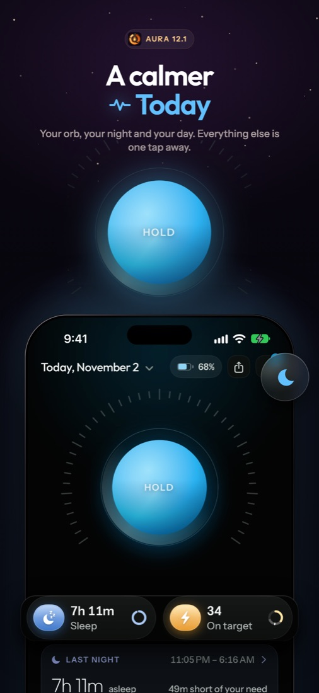
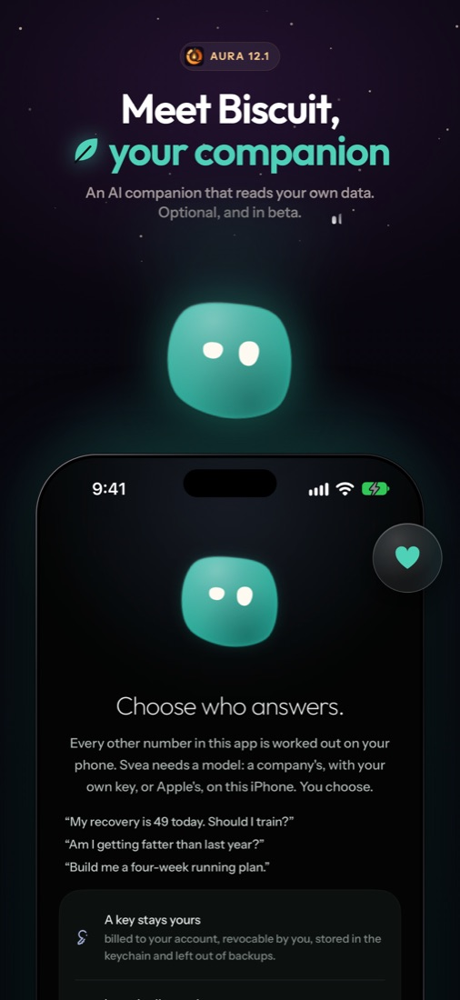
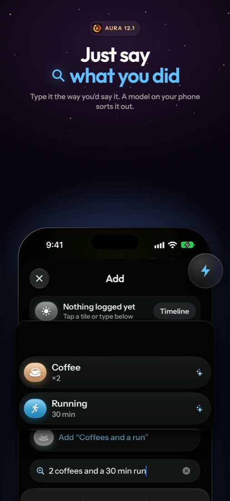
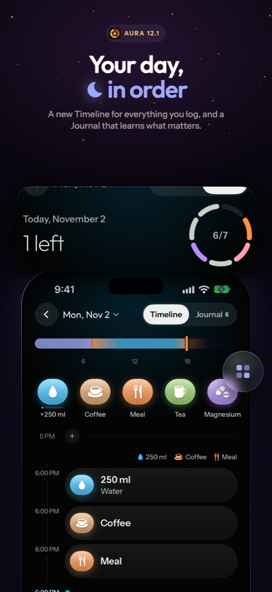
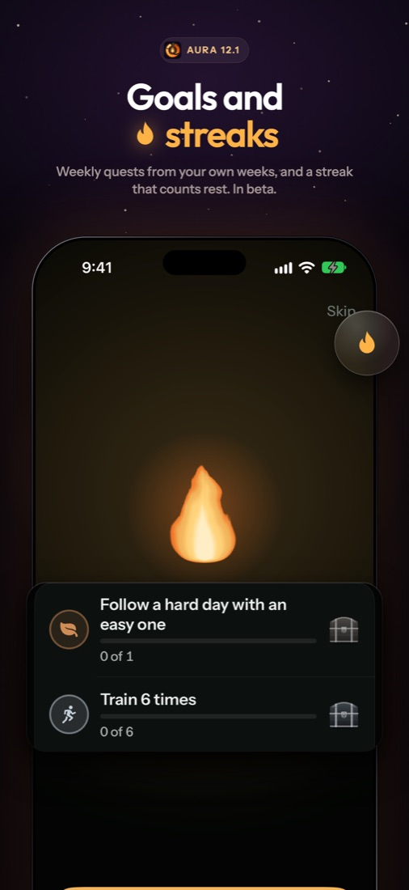
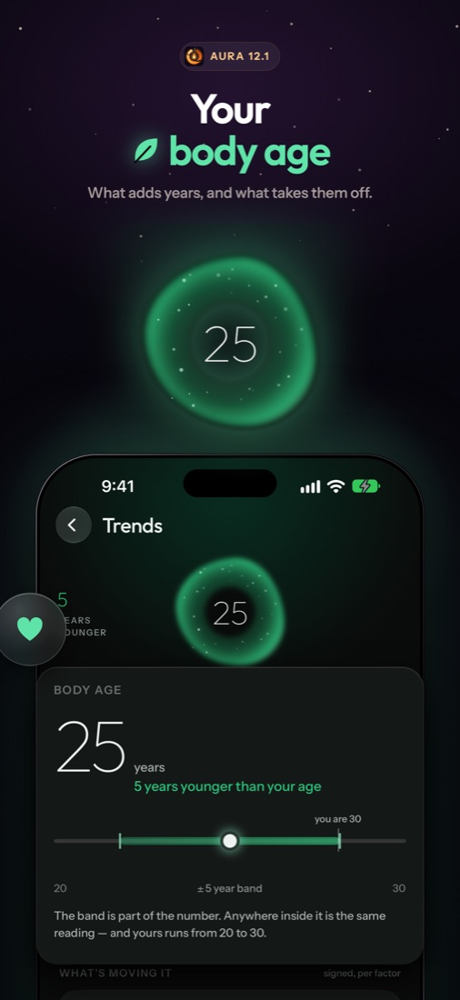

# Aura

*Your health, understood. Privately.*

Aura is a personal health app that helps you sleep better, recover smarter, train with purpose and see how you're aging, one day at a time.

Everything is worked out on your phone and stays there. No account, no subscription, no cloud.

  
  
  

  
  
  

- **Sleep and recovery:** how well you rested, and what it means for today.
- **Your body age:** what adds years, and what takes them off.
- **Training:** sessions, routines, routes and your progress, with Strava and Hevy.
- **Log anything:** type it the way you'd say it. Aura sorts it out on your phone.
- **Your journey:** goals, streaks, bloodwork, weight and a daily journal.
- **Biscuit:** an optional AI companion that reads your own data.

Aura reads heart-rate straps and smart scales, and brings in your history from other apps and devices. Every release goes further.

**[Download Aura](https://github.com/gdorgian/aura/releases/latest)**: install the IPA with your usual sideloading tool. Updates arrive inside the app from then on.

Questions and bug reports: [Issues](https://github.com/gdorgian/aura/issues).

Aura is not a medical device. Built on [NOOP](https://github.com/ryanbr/noop). See [LICENSE](LICENSE) and [NOTICE](NOTICE).
